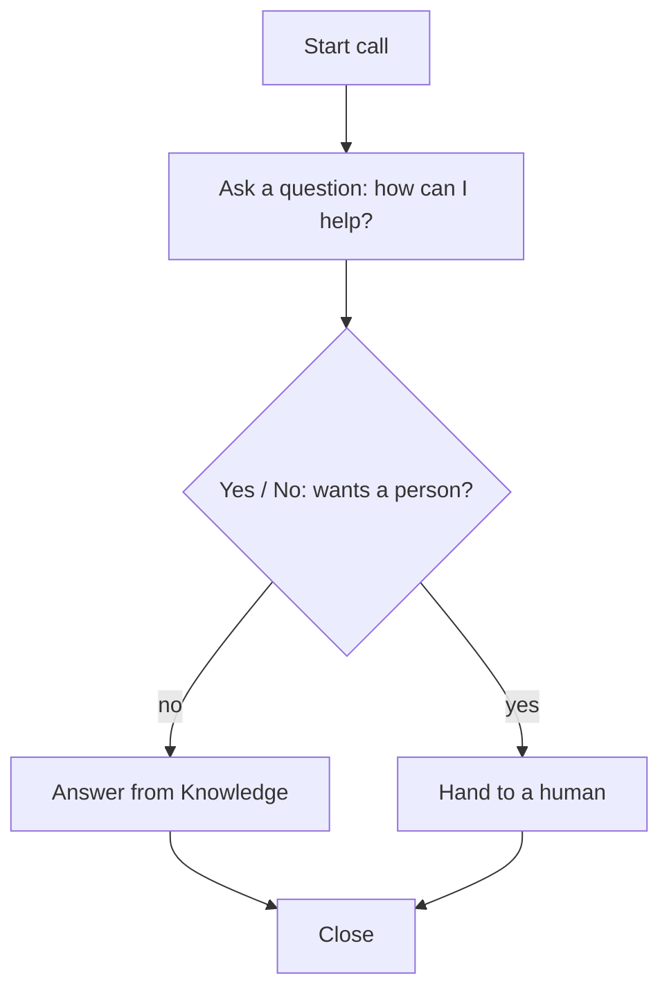
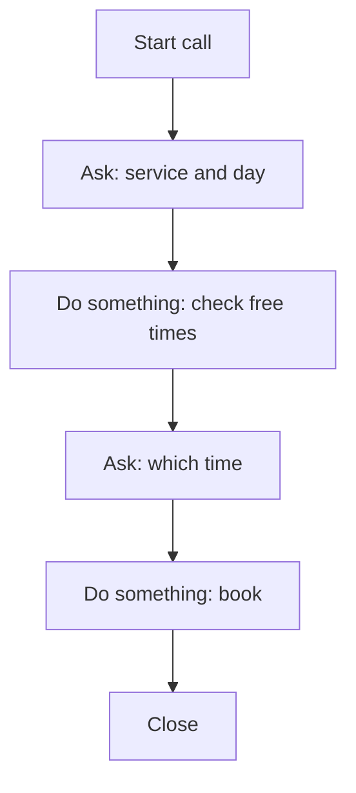
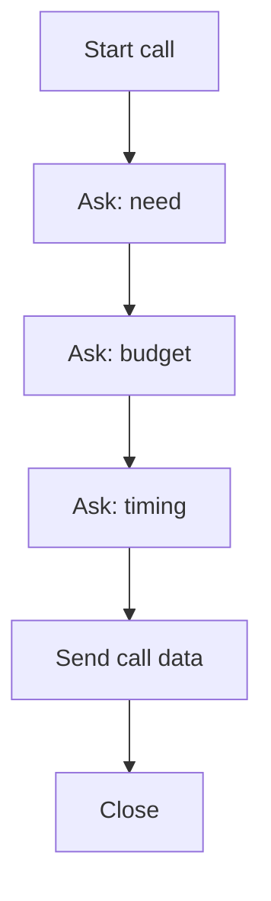
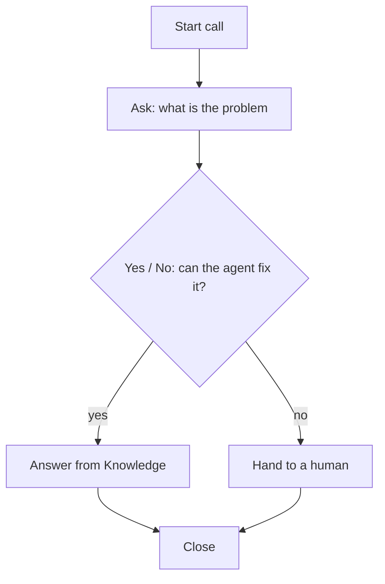

import Shot from '../../../components/Shot.astro';

The **Flow** view of an agent shows the call as a diagram that runs from top to bottom. The **Configuration** view holds the other settings. Use the switch at the top of the agent page to move between them.

<Shot name="agent-detail" alt="Call flow editor with a step palette, a top-to-bottom flow and a help panel" caption="The Flow view: palette on the left, canvas in the middle, help and checks on the right." />

## The canvas
The flow fills the page. Steps are cards. Lines between them are connections.
- Pick a step in the palette to add it to the canvas.
- Click a step or a line to edit it in the panel on the right.
- Drag from a dot on one step to another step to connect them.
- Select a step or line and press **Backspace** or **Delete** to remove it.

## Step types
| Step | Use it to |
|---|---|
| **Start call** | Decide how the call begins, for example "Hi, thanks for calling! How can I help?" Every flow needs exactly one. |
| **Ask a question** | Collect information, such as the caller's name. |
| **Do something** | Use a tool, such as checking a calendar and booking a slot. |
| **Yes / No check** | Branch the call: its two outgoing connections carry yes and no conditions. |
| **Hand to a human** | Pass the call to a person. |
| **Close** | End the call politely. Every flow needs at least one. |
| **Global rules** | Instructions that apply all the time, such as "keep answers short". It floats on its own with no connections. |
| **Send call data** | When the call ends, send what was learned to a web address. |
| **API trigger** | Let your own software start calls with this agent. See [API trigger node](/developers/api-trigger/). |
| **Call quality check** | Read each finished call and score how well the agent did. |
| **Advanced step** | A step set up elsewhere. You can move it but its settings are kept as they are. |

## Edit a connection's condition
Click a line to write the condition that decides when the call follows it, such as "caller wants to book".

## Buttons
- **Tidy up:** arranges steps neatly top to bottom.
- **Reset:** puts back the starter flow.
- **Try a call:** see below.

## Checks before saving
- A flow needs exactly one Start call step: "Your flow needs exactly one Greeting step so the agent knows how to start."
- A flow needs a Close step: "Add a Close step so calls end politely."
- A flow can have up to 100 steps.

## Try a call
**Try a call** saves your flow first, then lets you have a typed conversation with the draft on the private Test copy. It uses your real instructions, tools and knowledge. It does not ring a phone and it does not test the voice. For voice, press **Talk** ([Test your agent](/agents/test-your-agent/)).

## Common patterns

### Receptionist

### Booking

### Lead qualification

### Support triage

## Related
- [Tools](/agents/tools/)
- [Versions and publishing](/agents/versions-and-publishing/)
