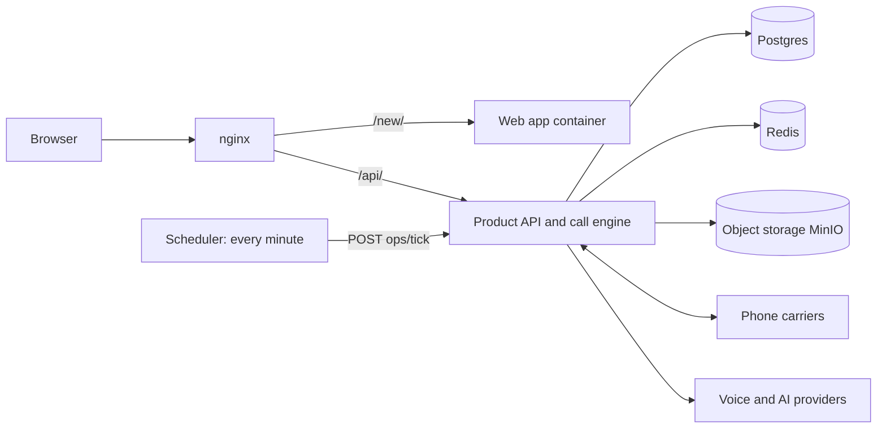

:::note
This section is for the person hosting Swarvo AI. Customers can ignore it.
:::

- **Web app:** static files in a small container, served under `/new/`.
- **Product API:** routes under `/api/v1/product/*` and `/api/v1/public/*`, inside the platform's API.
- **Postgres:** all data. **Redis:** rate limits and background coordination. **Storage:** audio files.
- **Carriers:** Twilio, Plivo or customers' own carriers deliver calls.
- **Voice and AI providers:** keys are kept in model profiles in the database, never shown to customers.
